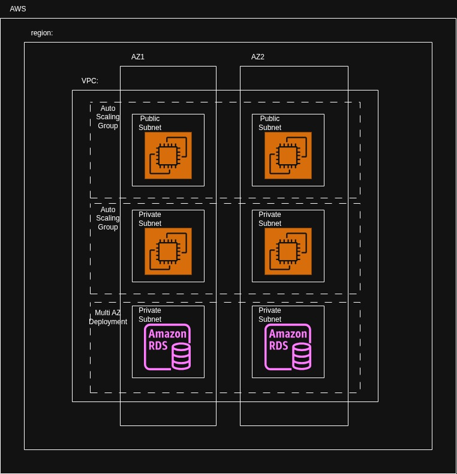

# cloudformation-task-1
IAC Course, CloudFormation Assignment#1

Student ID: L00205331

Student Name: Manal Elhawa

=============================================================================
### Code

The cloudformation templates can be found in [templates](./cloudformation/templates)

=============================================================================
### Design

- For the static website, I used cloudfront ( for content delivery) & S3 (to storae the static web page). After creating the stack, I upload the [index.html](./website/index.html) manualy to the S3 bucket. Screenshots can be found in [Static Website](./output/Test-Final:1-Nov/Static%20Website/)

- For the 3 tier website, I wanted to build a highly available website.


- However, the DB multi-AZ deployment is not available in the AWS free tier account. So I created a single RDS instance.

- It is recommended to use HTTPS insetad of HTTP. But since this is a lab environment, I used HTTP for simplicity.

- In a production setup tags are important to track ownership and billing. As a sample I have created tags for the environment, orgnaization and name.

- Also in a production setup, the DB password will be stored in a seceret managemnt system (example: Hashicorp vault). But since this is not available here, I have added the password as a user variable.

- I have created bith the Web and APP layers as EC2 scaling groups for high availability. I used application load balancers for the web and app layers to balance load on the EC2 instances.

- I used the web instances as a reverse proxy for the application. And the application queries the DB. This is just to validate the connectivity Web --> APP --> DB.

- Both the APP & DB are in private subnets. Unlike the web which is hosted in a public subnet and is reachable through the intenet gateway.

=============================================================================
### Work Log

- Monday 19-Oct

Tested the template file only using the CloudFront & S3.

After uploading the template, I uploaded the index.htm to the S3 bucket 

- Friday 30-Oct

Tested the template file for the 3 tier website to create: VPC, Public & Private subnets, and security groups.

- Saturday 31-Oct

Tried to add tags to all resources, but they are not supported under Scaling groups, launch templates, attache gateway,...

Added tags to the static website
=============================================================================
### References

- The below files were generated by ChatGPT(GPT-5.6 Luna):
1. CODE_OF_CONDUCT.md
2. CONTRIBUTING.md
3. SECURITY.md

Prompt: 

```what files should I add to a github repo (similar to a README file) to follow git repos best practices? Given that the repo will include a cloudformation project to deploy a website on AWS using cloudformation?```

-----------------------------------------------------------------------------------------------------
- All the template files that I have used as referene can be found in [REF](./Ref/)

- Used Lab 05 & 06 CloudFormation stack files in the AWS Cloud Foundation course as reference. 

- Used the architecture in [Building and Deploying a 3-tier Architecture with AWS CloudFormation](https://medium.com/@nifemi.sofowoke/building-and-deploying-a-3-tier-architecture-with-aws-cloudformation-415f198c1cda) as a reference. This example had 3 Tier website, but the app, web and DB don't communicate with each other. And both the app and web layers serve a static page. And no tags were added to any resources.

- [CloudFormation Templates](https://github.com/aws-cloudformation/aws-cloudformation-templates/)

-----------------------------------------------------------------------------------------------------
